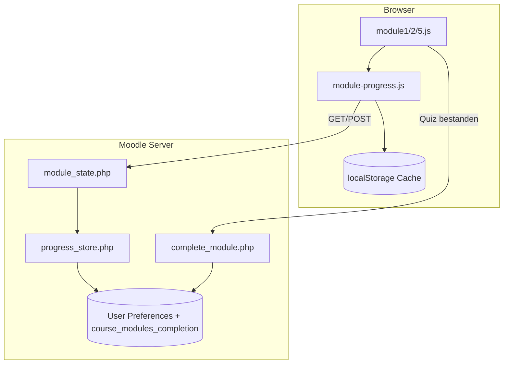

# Übersicht: Eigene Entwicklung Peer4You

**Arbeitsdokument** für Projektdokumentation (~25 S.), Berichtsteil und Agent-Kontext.  
Stand: Juni 2026 · Branch `MOODLE_502_STABLE`

---

## 1. Projektziel & Kontext

**Peer4You** ist ein E-Learning-System zur Ausbildung von **Peer-Schuldenberater:innen** für die Diakonie Baden-Baden und Rastatt. Der Kurs umfasst **6 Module** (Einführung, Finanzwissen, Kommunikation, Datenschutz, Krisen, Abschluss).

- **Auftraggeber / Fachseite:** Diakonie (Seeker: Jürgen Zechiel)
- **IT-Produktion:** Dienstleister Hoell (Installation auf Diakonie-VM per Anleitung)
- **Entwicklungsstand:** Referenzserver `https://lms.schulerwebdesign.de` (Coolify/Hetzner)
- **Abgabe:** Git-Repository + Moodle bis 05.07.2026

---

## 2. Technische Basis

| Aspekt | Entscheidung |
|--------|--------------|
| LMS | Moodle **5.2 Stable** (`MOODLE_502_STABLE`) |
| PHP | 8.3+ |
| Datenbank | MariaDB 11.4 |
| Container | Docker Compose (`web`, `db`, `cron`) |
| Anpassungsstrategie | **Keine Core-Hacks** — nur Theme + Local Plugin + CLI |
| Referenz-UX | HTML-Prototyp unter `Dateien/entwuerfe_und_artefakte/prototype/` |

---

## 3. Komponenten-Matrix

| Komponente | Pfad | Status |
|------------|------|--------|
| Theme `theme_p4u` | `public/theme/p4u/` | Login, Dashboard, Diakonie-Branding, Boost-Drawers |
| Plugin `local_p4u` | `public/local/p4u/` | M1/M2/M5 interaktiv; M3/M4/M6 Platzhalter |
| Fortschritt / API | `module_state.php`, `progress_store.php`, `module-progress.js` | Server (User Preferences) + localStorage-Cache |
| Moodle-Completion | `complete_module.php` | Abschluss nur nach Quiz ≥ 60 % |
| CLI Kursstruktur | `local/p4u/cli/create_training_modules.php` | 6 Abschnitte, Availability-Kette |
| Docker-Stack | `docker-compose.yml`, `docker/php/` | Lokaler Dev-Stack |
| Handoff | `scripts/handoff/` | `.mbz`-Export für Kunde |
| Infra-Deploy | Coolify/Hetzner | Außerhalb Git — Doku in `docs/07-*` |

---

## 4. Architektur (Fortschritt & Completion)



### Zwei Ebenen

1. **Stationen-Fortschritt** (pro Nutzer): besuchte Abschnitte, interaktiver Zustand — primär in DB (`local_p4u_module{N}_progress`), Browser-Cache als Fallback.
2. **Modul-Abschluss** (Moodle-Kurs): erst nach bestandenem Abschlussquiz (≥ 60 %) via `complete_module.php` → `course_modules_completion`.

### Availability-Kette (Demo)

`create_training_modules.php` sperrt sequenziell: **M1 → M2 → M5** (M3/M4/M6 ausgenommen, da Platzhalter).  
Produktion (Ziel): M1 → M2 → M3 → M4 → M5 → M6.

Details: [09-interactive-modules-architecture.md](09-interactive-modules-architecture.md)

---

## 5. Git vs. Datenbank vs. moodledata

| Liegt in | Beispiele | Wer / Wie |
|----------|-----------|-----------|
| **Git (Team-Code)** | `theme/p4u`, `local/p4u`, `docker/`, `scripts/handoff/`, `docs/` | Projektgruppe — `git push` → Deploy |
| **Git (Moodle Core)** | `public/lib/`, `admin/`, Standard-Themes | Moodle HQ / Community |
| **Nicht im Git** | Kursinhalte, Quiz (Moodle-UI), Nutzer, Uploads, `config.php` | Server-Konfiguration / Seeker-Inhalte |

**Regel:** Code reist mit Git; Inhalte reisen per **`.mbz`-Backup** oder manueller Moodle-Konfiguration.

Nach Git-Deploy auf Server zusätzlich ausführen:

```bash
php local/p4u/cli/create_training_modules.php
php admin/cli/purge_caches.php
```

Vollständig: [08-environments-and-customer-handoff.md](08-environments-and-customer-handoff.md)

---

## 6. Modul-Status M1–M6

| Modul | Titel | Status | Dateien |
|-------|-------|--------|---------|
| M1 | Einführung & Rollenverständnis | **Interaktiv** | `module1.php`, `module1.js` |
| M2 | Finanzwissen | **Interaktiv** | `module2.php`, `module2.js` |
| M3 | Kommunikation | Platzhalter | `module_placeholder.php?module=3` |
| M4 | Digitale Sicherheit | Platzhalter | `module_placeholder.php?module=4` |
| M5 | Krisen erkennen | **Interaktiv** | `module5.php`, `module5.js` |
| M6 | Abschluss | Platzhalter | `module_placeholder.php?module=6` |

Cut-off Seeker-Inhalte M3/M4/M6: **22.06.2026** — keine Lieferung; Platzhalter bleiben.

---

## 7. Offene Punkte

| Thema | Stand |
|-------|-------|
| Review P1 Deploy | Code 17.06. (Quiz 2-Phasen, Availability M1→M2→M5) — **Deploy auf Referenzserver ausstehend** |
| Quiz Typ A vs B | Manager-Entscheid offen (JS-Quiz vs. Moodle-Quiz-Aktivität) |
| M3/M4/M6 Inhalte | Platzhalter; Produktions-Kette 1→6 nach Inhaltslieferung |
| Journey-Chips (Dashboard) | Bewusst offen (P2 Review) |
| Kunden-VM | Installation durch Hoell per IT-Anleitung |

---

## 8. Team-Beiträge (Skelett — vom Team ausfüllen)

### Niklas *(Nachname)*

- Theme `theme_p4u`: Login-Branding, Dashboard-Layout, SCSS-Tokens
- Docker/Coolify-Deploy, Referenzserver `lms.schulerwebdesign.de`
- Dokumentation (`docs/`), Handoff-Skripte, Stakeholder-Kommunikation (Seeker, Hoell)
- Review-Sprint P1/P2 Code (mit Alexander)

### Alexander *(Nachname)*

- Interaktive Module M1, M2, M5 (`module*.php/js`)
- Seeker-Inhalte eingearbeitet; M3/M4/M6 Platzhalter
- `complete_module.php`-Flow, Quiz-Logik

### Gemeinsam

- CLI `create_training_modules.php`, Architektur Fortschritt/API
- Abschlusspräsentation, Projektdokumentation

*Vor Abgabe: konkrete Aufgaben, Stunden und Meilensteine ergänzen.*

---

## Verwandte Dokumente

- [03-customization-strategy.md](03-customization-strategy.md)
- [09-interactive-modules-architecture.md](09-interactive-modules-architecture.md)
- [08-environments-and-customer-handoff.md](08-environments-and-customer-handoff.md)
- [05-theme-p4u-runbook.md](05-theme-p4u-runbook.md)
